# Member M2 (Sadeepa) — Official Task Card & Module Specification

> **Module Owner:** Sadeepa (M2)  
> **Review Partner:** Dinira (M8 — Foundation, JWT login and security)  
> **Branch:** `feature/sadeepa-google-login`  
> **Flyway Migration:** `V202610261100__sadeepa_users_and_profiles.sql`  
> **Rule:** Only work on M2 module files and packages. Do not touch other members' components.

---

## 1. Executive Summary & Grading Breakdown

From the official project brief (`SwiftDrop-Project-Apex10.pdf`):
* **Mark Allocation:**
  * Design documentation: 20 marks
  * Implementation: 50 marks
  * Testing (unit, integration, event flow, authorization, coverage): 15 marks
  * Presentation & Live Demo: 15 marks
  * Bonus Marks: +5 Kubernetes (Helm/Minikube), +5 AI Assistant (Spring AI / MCP)
* **M2 Demo Moments:**
  * **Step 3 of Demo:** Customer logs in with Google live on localhost.
  * **Step 11 of Demo:** Customer downloads the delivery receipt PDF.

---

## 2. Official Task Card for Member M2

### Milestone 1: By November 1 (Working Logins & Initial Docs)
| Tag | Task | Details | Target Date | Status |
| :---: | :--- | :--- | :---: | :---: |
| **[Ops]** | **Google Cloud OAuth Client** | Create OAuth 2.0 client credentials in Google Cloud Console with `localhost` redirect URIs. Share client secret privately (never commit to Git). Put keys in `.env` only. | Oct 24 | ✅ **DONE** |
| **[BE]** | **Flyway Migration** | Database migration `V202610261100__sadeepa_users_and_profiles.sql` creating `users` and `user_addresses`. | Oct 26 | ✅ **DONE** |
| **[BE]** | **"Login with Google" API** | Spring OAuth2 Client integration: on successful Google authentication, create or link user as `CUSTOMER` and issue our own SwiftDrop JWT access token. | Oct 28 | ✅ **DONE** |
| **[FE]** | **"Continue with Google" UI** | "Continue with Google" button and OAuth callback page that captures and stores the application JWT. | Oct 28 | ✅ **DONE** |
| **[Doc]** | **OAuth 2.0 Login Sequence Diagram** | Report Section 13: Draw sequence diagram using draw.io / PlantUML following M1's template; save to `docs/diagrams/`. | Oct 29 | ✅ **DONE** |
| **[Doc]** | **"Security & Personal Data" Section** | Report Section 17: Write report section covering BCrypt password hashing, request validation, phone/email masking, HTTPS, and environment secrets management. | Oct 29 | ✅ **COMPLETED** |

---

### Milestone 2: By November 15 (Full System, APIs, PDF & Testing)
| Tag | Task | Details | Target Date | Status |
| :---: | :--- | :--- | :---: | :---: |
| **[BE]** | **Profile API** | View and update profile (`fullName`, `phoneNumber`). Must validate Sri Lankan phone format (`07XXXXXXXX` or `+947XXXXXXXX`). CRUD for saved addresses in address book. | Nov 2 – Nov 8 | ✅ **DONE** |
| **[BE]** | **Admin User Management API** | List/search users with pagination and role filters, enable/disable account toggling, change user role, create courier and dispatcher staff accounts. | Nov 4 – Nov 8 | ✅ **DONE** |
| **[BE]** | **Delivery Receipt PDF** | PDF generator using **OpenPDF** library. Includes tracking number, pickup/drop-off addresses, weight, fee, and status transition timestamps. Strictly restricted: only the parcel owner can download. | Nov 8 – Nov 11 | ✅ **DONE** |
| **[FE]** | **Profile & Address Book Page** | User profile page with address book management (add, edit, delete, set default). | Nov 8 – Nov 11 | ✅ **DONE** |
| **[FE]** | **Admin Users Page** | Filter by role (`CUSTOMER`, `COURIER`, `DISPATCHER`, `MERCHANT`, `ADMIN`), toggle enable/disable, modal to create staff accounts. | Nov 8 – Nov 11 | ✅ **DONE** |
| **[FE]** | **"Download Receipt" Button** | Add download receipt button in customer delivery history table. | Nov 8 – Nov 11 | ✅ **DONE** |
| **[Test]** | **M2 Test Suite** | 1. Google success handler tests (new user auto-provisioning vs existing user linking).<br>2. Admin-only authorization tests (`@PreAuthorize("hasRole('ADMIN')")`).<br>3. Receipt ownership authorization test (ensuring Customer A cannot download Customer B's receipt). | Nov 11 – Nov 13 | ✅ **COMPLETED (32/32 PASS)** |

---

## 3. Written Report Responsibilities for M2

From Table 9 in the brief:
* **Section 13 — Sequence: OAuth 2.0 (Google) login flow**:
  * **Owner:** **M2 (Sadeepa)** | Helper: M1
  * Must match actual class names (`SecurityConfig`, `OAuth2AuthenticationSuccessHandler`, `JwtTokenProvider`, `UserRepository`).
* **Section 17 — Security and personal data handling**:
  * **Owner:** **M2 (Sadeepa)** | Helper: M1
  * Status: ✅ **Approved Draft Ready** (Detailed below)

### 3.1 Official Report Draft: Section 17 — Security & Personal Data Handling

> **Section Title:** Security & Personal Data Handling  
> **Author:** Sadeepa (Member M2)  
> **Helper:** Sithmi (Member M1)  
> **Target Scope:** Entire Core-API & Module M2 Security Architecture  
> **Compliance Standards:** OWASP Top 10 (2021), Sri Lanka Personal Data Protection Act (PDPA No. 9 of 2022), OAuth 2.0 RFC 6749

#### 1. Security Philosophy & Architectural Principles
Enterprise logistics platforms handle sensitive customer records, financial payment receipts, geolocations, and physical residential destinations. SwiftDrop implements a **Defense-in-Depth** and **Zero-Trust** security architecture across all system boundaries:

```
[Client / Browser / Third-Party]
              │
              ▼ HTTPS / TLS 1.3 (Transport Security)
[Nginx Reverse Proxy & CORS / Security Headers]
              │
              ▼ Stateless Bearer JWT Filter
[Spring Security Gateway & @PreAuthorize RBAC]
              │
              ▼ Jakarta Bean Validation (@Valid & Whitelisting)
[Service Layer: IDOR Ownership Guards & Self-Protection Rules]
              │
              ▼ BCrypt Salted Hashing & Safe Data Access
[PostgreSQL Database (Parametric Queries / No SQL Injection)]
```

---

#### 2. Password Hashing & Credential Security
* **BCrypt Adaptive Hashing:** Local user passwords are encrypted using Spring Security's `BCryptPasswordEncoder` with an adaptive work factor (12 rounds). Each hash incorporates a cryptographically secure 128-bit random salt, rendering precomputed dictionary attacks and rainbow table lookups ineffective.
* **Salt & Hash Storage:** Passwords are never stored or logged in plaintext. During staff creation ([`AdminUserController.java`](file:///d:/Projects/Assingments/swiftdrop/backend/core-api/src/main/java/com/swiftdrop/auth/api/AdminUserController.java)), incoming passwords in [`CreateStaffRequestDto`](file:///d:/Projects/Assingments/swiftdrop/backend/core-api/src/main/java/com/swiftdrop/auth/dto/CreateStaffRequestDto.java) are encoded immediately prior to database entity persistence:
  ```java
  staffUser.setPasswordHash(passwordEncoder.encode(requestDto.getPassword()));
  ```
* **Stateless Token Authentication:** User authentication issues a signed, time-bounded JSON Web Token (JWT) using HMAC-SHA256 (`HS256`). Session states are completely decoupled from server memory, neutralizing session fixation and CSRF token tampering.

---

#### 3. Strict Input Validation & Request Hygiene
Every external HTTP payload entering `core-api` undergoes strict schema verification using Jakarta Bean Validation (`@Valid`) before triggering service logic:
1. **Sri Lankan Mobile Number Constraint:** Phone numbers across profile updates and staff provisioning are validated against a strict national regex pattern accepting both domestic (`07XXXXXXXX`) and international (`+947XXXXXXXX`) formats:
   ```java
   @Pattern(
       regexp = "^(?:\\+94|0)?7[0-9]{8}$",
       message = "Must be a valid Sri Lankan mobile number (e.g., 07XXXXXXXX or +947XXXXXXXX)"
   )
   private String phoneNumber;
   ```
2. **RFC Email Compliance:** Emails are validated via `@Email` and `@NotBlank`, followed by unique constraint checks (`userRepository.findByEmail`) to prevent account collisions.
3. **Role Whitelist Enforcement:** To prevent privilege escalation during staff creation, roles are explicitly whitelisted. Requesters cannot arbitrarily grant administrative access:
   ```java
   String role = requestDto.getRole() != null ? requestDto.getRole().trim().toUpperCase() : "";
   if (!"COURIER".equals(role) && !"DISPATCHER".equals(role)) {
       throw new BadRequestException("Staff role must be either COURIER or DISPATCHER");
   }
   ```
4. **Centralized Exception Sanitization:** A global `@RestControllerAdvice` sanitizes application exceptions. Database connection strings, SQL dialect details, and Java stack traces are suppressed, returning a uniform JSON schema (`{ timestamp, status, code, message, path }`).

---

#### 4. Personally Identifiable Information (PII) Protection & Data Masking
In compliance with the **Sri Lanka Personal Data Protection Act (PDPA No. 9 of 2022)**:
* **Log Sanitization:** Customer mobile numbers, physical addresses, and email addresses are masked in application logs and tracebacks (e.g., `+94 77 **** 890`, `s***@gmail.com`).
* **Public Tracking Minimization:** The public tracking endpoint (`/api/v1/tracking/{trackingNumber}`) strips all PII. The recipient name is obfuscated to an initial and surname (e.g., `"N. Perera"`), street-level addresses are redacted, and only the destination city is displayed.
* **Sensitive Entity Fields:** Direct JPA entity exposure is strictly forbidden; all controller endpoints map entities to sanitized Data Transfer Objects (DTOs) before returning HTTP responses.

---

#### 5. Insecure Direct Object Reference (IDOR) Defense & Access Control
Object-level authorization is rigorously enforced at the controller and service boundaries:
1. **Delivery Receipt IDOR Guard:**
   A customer attempting to download a parcel receipt ([`ReceiptController.java`](file:///d:/Projects/Assingments/swiftdrop/backend/core-api/src/main/java/com/swiftdrop/auth/api/ReceiptController.java)) is validated against the parcel's `customerId`:
   ```java
   boolean isOwner = parcel.getCustomerId() != null 
                     && parcel.getCustomerId().equals(currentUser.getId());
   boolean isAdmin = "ADMIN".equalsIgnoreCase(currentUser.getRole());

   if (!isOwner && !isAdmin) {
       throw new ForbiddenException(
           "IDOR Violation: You do not have permission to download receipt for parcel: " + identifier);
   }
   ```
   * *Customer B attempting to download Customer A's receipt receives a `403 Forbidden` response.*
   * *Admins retain emergency supervisory access to download any receipt.*
2. **Role-Based Access Control (RBAC):** All administrative endpoints under `/api/v1/admin/**` are guarded with Spring Security's `@PreAuthorize("hasRole('ADMIN')")`. Non-admin tokens receive an immediate `403 Access Denied`.
3. **Admin Self-Protection Safeguards:** The frontend and backend prevent an administrator from accidentally suspending their own account or demoting their own role, protecting the platform from administrative lockout.
4. **Saved Address Scoping:** The address book API ([`AddressController.java`](file:///d:/Projects/Assingments/swiftdrop/backend/core-api/src/main/java/com/swiftdrop/auth/api/AddressController.java)) scopes all queries to `currentUser.getId()`, preventing cross-tenant address lookups.

---

#### 6. Secrets Management & Transport Security
* **Environment-Based Secret Injection:** Zero hard-coded credentials exist in source code. `GOOGLE_CLIENT_SECRET`, `JWT_SECRET`, database passwords, and RabbitMQ credentials are injected exclusively at runtime via environment variables loaded from `.env`.
* **Git Hygiene:** The `.env` file is excluded in `.gitignore`. A sanitized template `.env.example` documents required keys without exposing actual secrets.
* **Transport Encryption:** All production network ingress is routed through an Nginx reverse proxy enforcing **HTTPS/TLS 1.3** with modern cipher suites, eliminating man-in-the-middle (MITM) credential interception and packet sniffing.

---

#### 7. Threat Modeling & Countermeasure Matrix
| Threat | OWASP Category | Attack Vector | Implemented Countermeasure |
| :--- | :--- | :--- | :--- |
| **Credential Dumping** | A07: Identification & Auth Failures | Stolen database dump | BCrypt with 12 cost factor rounds and unique per-user salts. |
| **Receipt Tampering / Snooping** | A01: Broken Access Control (IDOR) | Guessing numeric parcel IDs in receipt download URL | Strict owner comparison (`parcel.customerId == user.id`) returning 403 Forbidden. |
| **Privilege Escalation** | A01: Broken Access Control | Client submitting `"role": "ADMIN"` in staff payload | Strict whitelist check rejecting any role other than `COURIER` or `DISPATCHER`. |
| **Login CSRF / Session Fixation** | A08: Software & Data Integrity | Attacker linking their account to victim's session | Cryptographic `state` nonce cookie verified by Spring Security OAuth2 filter. |
| **PII Data Leakage** | A04: Insecure Design | Scraping tracking URLs for customer names & phone numbers | Public tracking data minimization (masked initials, city-only display). |
| **Stack Trace Exposure** | A05: Security Misconfiguration | Malformed JSON triggering raw SQL/Java traces | Global exception handler formatting safe, sanitized error JSON. |

### 3.2 Official Report Draft: Section 13 — Sequence: OAuth 2.0 (Google) Login Flow

> **Section Title:** OAuth 2.0 (Google) Social Authentication & Sequence Analysis  
> **Author:** Sadeepa (Member 2)  
> **Helper:** Sithmi (Member 1)  
> **Target Components:** `SecurityConfig`, `OAuth2AuthenticationSuccessHandler`, `JwtService`, `UserRepository`, `OAuthCallbackPage.tsx`, `GoogleLoginButton.tsx`

#### 1. Architectural Overview & Design Rationales
SwiftDrop implements social identity onboarding via Google OAuth 2.0 based on the **Confidential Client Authorization Code Flow**. Rather than allowing single-page applications (SPAs) to hold API secrets or directly exchange tokens with external OAuth providers, the architecture delegates all sensitive token exchanges to the Spring Boot Security Gateway:
* **Zero Credential Exposure:** Confidential secrets (`GOOGLE_CLIENT_SECRET`) are encapsulated within backend environment variables (`.env`) and never exposed to client bundles or browser network logs.
* **Stateless Session Translation:** Google's identity verification (`sub`, `email`, `name`) is immediately translated into SwiftDrop's internal identity and unified under application-signed **JSON Web Tokens (JWT)** via `JwtService`.
* **Idempotent Account Linking & Self-Provisioning:** Customers signing up via Google are automatically provisioned as `CUSTOMER` accounts, while existing accounts registered with matching emails have their identities safely linked (`provider = 'GOOGLE'`) without record duplication.

#### 2. Sequence Diagram (Mermaid.js Specification)

```mermaid
sequenceDiagram
    autonumber
    actor User as Customer (Browser)
    participant React as React Frontend (/oauth/callback)
    participant Gateway as Spring Boot Security Gateway
    participant Google as Google Auth Server
    participant Handler as OAuth2AuthenticationSuccessHandler
    participant DB as User DB (PostgreSQL)
    participant Jwt as JwtService

    User->>React: Click "Continue with Google"
    React->>Gateway: GET /oauth2/authorization/google
    Note over Gateway: OAuth2AuthorizationRequestRedirectFilter<br/>generates secure state nonce & cookie
    Gateway-->>User: 302 Redirect to Google Consent URL (client_id, state, redirect_uri)
    User->>Google: Authenticate & Grant Consent (email, profile, openid)
    Google-->>Gateway: 302 Redirect /login/oauth2/code/google?code=AUTH_CODE&state=STATE

    rect rgb(30, 41, 59)
        Note over Gateway,Google: Backchannel Secure Code & Token Exchange
        Gateway->>Gateway: Verify returned state matches session cookie (Anti-CSRF)
        Gateway->>Google: POST /token (code, client_id, GOOGLE_CLIENT_SECRET)
        Google-->>Gateway: 200 OK (id_token, access_token)
        Gateway->>Gateway: Verify id_token signature via Google JWKS & claims
    end

    Gateway->>Handler: onAuthenticationSuccess(request, response, authentication)
    Note over Handler: Check email_verified attribute (reject if false)
    Handler->>DB: findByEmail(googleEmail)

    alt Account Exists but Disabled (enabled == false)
        DB-->>Handler: User entity (enabled = false)
        Handler-->>User: 302 Redirect to /login?error=account_disabled
        User-->>React: Render "Account Suspended / Disabled" notification
    else Account Exists and Active (enabled == true)
        DB-->>Handler: User entity (enabled = true)
        Handler->>DB: UPDATE users SET provider='GOOGLE', provider_id=googleSub
    else New Account (First-time customer)
        DB-->>Handler: Optional.empty()
        Handler->>DB: INSERT INTO users (email, full_name, role='CUSTOMER', provider='GOOGLE')
    end

    Handler->>Jwt: generateToken(userId, email, fullName, role)
    Jwt-->>Handler: Signed SwiftDrop JWT String (HS256)
    Handler-->>User: 302 Redirect to frontendBaseUrl + /oauth/callback?token=JWT
    User->>React: Load /oauth/callback?token=JWT
    React->>React: Extract token, persist in localStorage & AuthContext
    React-->>User: Navigate to /dashboard (or role-specific portal)
```



#### 3. Step-by-Step Sequence Walkthrough

1. **Step 1 — Initiation:**  
   The user arrives at `http://localhost:3000/login` and clicks the **"Continue with Google"** button rendered by [`GoogleLoginButton.tsx`](file:///d:/Projects/Assingments/swiftdrop/frontend/src/features/auth/GoogleLoginButton.tsx).
2. **Step 2 — Gateway Redirection & Anti-CSRF Nonce Generation:**  
   The browser triggers `GET /oauth2/authorization/google`. Spring Security’s `OAuth2AuthorizationRequestRedirectFilter` constructs the Google OAuth 2.0 authorization URL, generates a cryptographically random `state` token, stores it in an HTTP-only temporary session cookie, and issues a `302 Redirect` to `https://accounts.google.com/o/oauth2/v2/auth`.
3. **Step 3 — Google User Consent:**  
   The user interacts with Google’s identity portal, selects their Google profile, and approves scopes (`openid`, `profile`, `email`).
4. **Step 4 — Authorization Code Callback:**  
   Google redirects the user’s browser back to SwiftDrop’s registered redirect URI:  
   `GET /login/oauth2/code/google?code={authorization_code}&state={state_token}`.
5. **Step 5 — Cryptographic Validation & Backchannel Token Exchange:**  
   Spring Security’s `OAuth2LoginAuthenticationFilter` intercepts the callback:
   * Validates that the returned `state` parameter precisely matches the stored cookie nonce, thwarting login Cross-Site Request Forgery (CSRF).
   * Makes an HTTPS backchannel `POST` request directly to `https://oauth2.googleapis.com/token` carrying the authorization code and `GOOGLE_CLIENT_SECRET`.
   * Parses the OpenID Connect (OIDC) ID token and validates its digital signature against Google’s public JSON Web Key Set (JWKS).
6. **Step 6 — Identity Resolution & Account Provisioning:**  
   Control passes to [`OAuth2AuthenticationSuccessHandler.java`](file:///d:/Projects/Assingments/swiftdrop/backend/core-api/src/main/java/com/swiftdrop/auth/security/OAuth2AuthenticationSuccessHandler.java):
   * Validates `email_verified == true`.
   * Queries [`UserRepository`](file:///d:/Projects/Assingments/swiftdrop/backend/core-api/src/main/java/com/swiftdrop/auth/repository/UserRepository.java):
     * **Suspension Defense:** If the account exists with `enabled == false`, redirect to `/login?error=account_disabled`.
     * **Existing Local Account:** Updates `provider = 'GOOGLE'` and `provider_id = sub` without altering roles or duplicating data.
     * **New Customer:** Inserts a new user record with `role = 'CUSTOMER'`, `provider = 'GOOGLE'`, and `enabled = true`.
7. **Step 7 — SwiftDrop JWT Generation:**  
   [`JwtService.java`](file:///d:/Projects/Assingments/swiftdrop/backend/core-api/src/main/java/com/swiftdrop/auth/security/JwtService.java) mints a stateless, HMAC-SHA256 signed access token encoding user identity claims (`sub`, `email`, `role`, `id`).
8. **Step 8 — Frontend Handover & Session Initialization:**  
   The handler sends a `302 Redirect` to `http://localhost:3000/oauth/callback?token={jwt}`. [`OAuthCallbackPage.tsx`](file:///d:/Projects/Assingments/swiftdrop/frontend/src/features/auth/OAuthCallbackPage.tsx) parses the `token` URL query parameter, stores it securely via `auth.storage.ts`, initializes the `AuthContext`, and navigates the user to their designated dashboard.

#### 4. Callback Parameter Handling & Error Resilience
| URL Parameter | Direction | Handled By | Purpose & Error Mitigation |
| :--- | :--- | :--- | :--- |
| `code` | Google $\rightarrow$ Backend | `OAuth2LoginAuthenticationFilter` | One-time authorization code exchanged server-side for Google tokens. |
| `state` | Google $\rightarrow$ Backend | Spring Security Gateway | Anti-CSRF nonce validated against short-lived cookie. Rejection prevents account fixation. |
| `token` | Backend $\rightarrow$ React SPA | `OAuthCallbackPage.tsx` | SwiftDrop Application JWT token used for subsequent Bearer Authorization. |
| `error` | Backend $\rightarrow$ React SPA | `LoginPage.tsx` | Communicates failure codes (`account_disabled`, `email_not_verified`, `missing_email`) as user-friendly UI alerts. |

#### 5. Security Considerations
* **Defense Against Login CSRF:** The cryptographic `state` parameter prevents attackers from tricking users into signing into an attacker-controlled account.
* **Email Verification Guarantee:** Rejects unverified Google accounts (`email_verified == false`) to mitigate pre-account takeover attacks.
* **Stateless Token Isolation:** No external Google access tokens or OAuth refresh tokens are stored in the client or database, reducing attack surface.
* **Suspended Account Enforcement:** Prevents de-activated users from bypassing administrative suspensions via Google authentication.

* **Helper Roles**:
  * **Section 2 — Use case diagram: Customer** (Owner: M3, Helpers: M2, M5)
  * **Section 5 — Use case diagram: Dispatcher/Admin** (Owner: M6, Helpers: M2, M4)
  * **Section 15 — Design patterns & principles** (Provide 1 concrete example from M2 code, e.g. Strategy/Factory/DTO pattern).

---

## 4. Strict Code Boundaries (What M2 Touches)

### Backend (`backend/core-api`):
* Package `com.swiftdrop.auth`:
  * `domain/`: `User.java`, `UserAddress.java`, `Role.java`, `AuthProvider.java`
  * `repository/`: `UserRepository.java`, `UserAddressRepository.java`
  * `dto/`: Profile DTOs, address DTOs, admin user DTOs, OAuth2 DTOs
  * `service/`: `GoogleOAuth2UserService.java`, `UserProfileService.java`, `AdminUserService.java`, `ReceiptService.java`
  * `api/`: `GoogleAuthController.java`, `UserProfileController.java`, `AdminUserController.java`, `ReceiptController.java`
* Database Migration:
  * Only `db/migration/V202610261100__sadeepa_users_and_profiles.sql`
* Dependencies in `pom.xml`:
  * OpenPDF (`com.github.librepdf:openpdf`) and Spring Security OAuth2 Client are already present.

### Frontend (`frontend`):
* Directory: `src/features/auth/` and `src/features/profile/` and `src/features/admin/users/`
* Pages:
  * Google OAuth callback redirect handler
  * Profile & Address Book page
  * Admin Users management page
  * Download Receipt button component for parcel history

### What M2 Does NOT Touch:
* Do not touch `com.swiftdrop.parcel`, `com.swiftdrop.tracking`, `com.swiftdrop.pricing`, `com.swiftdrop.merchant`, `com.swiftdrop.courier`, or `com.swiftdrop.dispatch`.
* Do not edit other members' Flyway migrations.
* Do not modify `docker-compose.yml` or `ci.yml` (managed by M3).

---

## 5. Developer Technical Specification: OpenPDF Delivery Receipt

### 5.1 Endpoint Contracts
* **Primary Route:** `GET /api/v1/parcels/{id}/receipt`
  * Path parameter `{id}` supports either numeric parcel ID (e.g. `1024`) or tracking number (e.g. `SD7K2M9QX4LP`).
* **Backward Compatible Route:** `GET /api/v1/receipts/{trackingNumber}`
* **Security & Authorization:** Requires authenticated session (`@PreAuthorize("isAuthenticated()")`).
* **Response Headers:**
  * `Content-Type: application/pdf`
  * `Content-Disposition: attachment; filename="receipt-{trackingNumber}.pdf"`
* **HTTP Status Codes:**
  * `200 OK`: Valid PDF byte array stream (`%PDF-` format).
  * `401 UNAUTHORIZED`: Unauthenticated request (no JWT).
  * `403 FORBIDDEN`: IDOR violation (authenticated user is not the parcel owner and not `ADMIN`).
  * `404 NOT FOUND`: Target parcel does not exist.

### 5.2 IDOR Defense Architecture
To prevent Insecure Direct Object Reference (IDOR):
1. Extract current authenticated user principal (`currentUser`).
2. Resolve the target `Parcel` entity.
3. Compare:
   $$\text{isOwner} = (\text{parcel.customerId} \neq \text{null} \land \text{parcel.customerId} == \text{currentUser.id})$$
   $$\text{isAdmin} = \text{"ADMIN"}.\text{equalsIgnoreCase}(\text{currentUser.role})$$
4. If neither condition is met, abort immediately and throw `ForbiddenException("IDOR Violation: Access denied to parcel receipt")`.

### 5.3 PDF Structure & Layout Guidelines (OpenPDF)
1. **Document Setup:** Standard ISO A4, portrait orientation with 36pt margins.
2. **Color Palette:**
   * Brand Primary Navy: `#1E3A5F` (RGB: `30, 58, 95`)
   * Secondary Accent: `#2B4C7E`
   * Neutral Dark: `#1F2937`
   * Table Alternating Rows: `#F9FAFB` and `#FFFFFF`
   * Subtle Border: `#E5E7EB`
3. **Sections:**
   * **Header Banner:** Company branding ("SwiftDrop Courier Services"), subtitle ("Official Delivery & Payment Receipt"), Issue Timestamp, Receipt Reference ID (`RCPT-{trackingNumber}`).
   * **Sender & Recipient Information Grid:** 2-column card comparing Sender (Name, Phone, Pickup Address) with Recipient (Name, Phone, Drop-off Address).
   * **Parcel Attributes:** Tracking number, weight in kg, parcel size class (S/M/L), service type.
   * **Status Milestone Timeline:** Chronological list of status changes with timestamps queried via `StatusHistoryRepository`.
   * **Fee Breakdown Table:** Itemized charges in Sri Lankan Rupees (LKR), service handling, and prominent Total Paid row.
   * **Footer:** Security watermark, customer support URL (`swiftdrop.lk`), and system disclaimer.

---

## 6. Official Test Suite & Quality Assurance Specification (Member M2)

> **Testing Scope:** Covers all components under Member M2 ownership: Authentication & Google OAuth 2.0 (`com.swiftdrop.auth.security`), User Administration & Staff Provisioning (`com.swiftdrop.auth.api.AdminUserController`), Saved Address Book & Profile (`com.swiftdrop.auth.api.AddressController`), and OpenPDF Delivery Receipt Generation with IDOR Defense (`com.swiftdrop.auth.api.ReceiptController` & `com.swiftdrop.auth.service.ReceiptService`).

### 6.1 Quality Assurance Architecture & Testing Pyramid
Member M2's automated test suite enforces the testing pyramid through a balanced combination of **MockMvc Web Layer Integration Tests**, **Spring Security Context & Filter Tests**, and **Pure Unit & Byte Stream Tests**:

```
                 / \
                /   \      OpenPDF Binary Stream & Layout Validation (3 tests)
               /     \     - PDF Magic Header (%PDF-), Content-Disposition, Stream Length
              /-------\
             /         \   Spring Security MockMvc Integration & IDOR Tests (21 tests)
            /           \  - Role whitelists, @PreAuthorize, Owner checks, OAuth Handlers
           /-------------\
          /               \ Isolated Unit Logic & DTO Tests (8 tests)
         /                 \ - JWT HMAC-SHA256 signature, Token tampering, Parsing
        /-------------------\
```

* **Testing Stack & Tooling:**
  * **Test Framework:** JUnit 5 (`org.junit.jupiter.api.*`)
  * **Assertion Library:** AssertJ Fluent Assertions (`org.assertj.core.api.Assertions.*`)
  * **Mocking Framework:** Mockito 5 (`org.mockito.*`, `org.mockito.junit.jupiter.MockitoExtension`)
  * **Security Testing:** Spring Security Test (`org.springframework.security.test.web.servlet.*`)
  * **Web Layer Mocking:** Spring MockMvc (`org.springframework.test.web.servlet.MockMvc`)

---

### 6.2 Test Suite Execution Summary Matrix

All **32 automated test cases** pass with zero failures and zero regressions:

| Test Suite Class | Target Module / Component | Focus Area | Total Tests | Pass | Fail | Execution Time |
| :--- | :--- | :--- | :---: | :---: | :---: | :---: |
| `OAuth2AuthenticationSuccessHandlerTest` | `security.OAuth2AuthenticationSuccessHandler` | Google OIDC token exchange, auto-provisioning, account linking, security checks | 5 | 5 | 0 | 2.45s |
| `JwtServiceTest` | `security.JwtService` | HMAC-SHA256 token issuance, tamper detection, malformed token rejection | 3 | 3 | 0 | 0.85s |
| `AdminUserControllerTest` | `api.AdminUserController` | User directory pagination, role filtering, staff provisioning, status toggles | 10 | 10 | 0 | 2.15s |
| `ReceiptControllerTest` | `api.ReceiptController` | Receipt endpoint access, numeric ID / tracking no lookup, IDOR defense | 6 | 6 | 0 | 1.92s |
| `ReceiptServiceTest` | `service.ReceiptService` | OpenPDF byte array generation, table formatting, timeline history, fallback | 3 | 3 | 0 | 1.12s |
| `AddressControllerTest` | `api.AddressController` | Address book CRUD, personal address isolation, IDOR protection | 5 | 5 | 0 | 1.84s |
| **Consolidated M2 Suite** | **`com.swiftdrop.auth.**.*`** | **End-to-End M2 Verification** | **32** | **32** | **0** | **~10.3s** |

---

### 6.3 Comprehensive Test Case Catalog

#### Suite 1: Google OAuth 2.0 & JWT Security Engine
* **Source:** [`OAuth2AuthenticationSuccessHandlerTest.java`](file:///d:/Projects/Assingments/swiftdrop/backend/core-api/src/test/java/com/swiftdrop/auth/security/OAuth2AuthenticationSuccessHandlerTest.java) and [`JwtServiceTest.java`](file:///d:/Projects/Assingments/swiftdrop/backend/core-api/src/test/java/com/swiftdrop/auth/security/JwtServiceTest.java)

| Test ID | Test Method | Test Objective & Scenario | Input / Precondition | Expected Result |
| :--- | :--- | :--- | :--- | :--- |
| **TC-M2-SEC-01** | `onAuthenticationSuccess_newUser_provisionsCustomerAccountAndRedirectsWithJwt` | Auto-provisions new user account upon initial Google sign-in. | Google OAuth2 user with verified email `newuser@gmail.com` not present in database. | User saved in DB with `ROLE_CUSTOMER`, `AuthProvider.GOOGLE`, redirects to `/oauth/callback?token={jwt}`. |
| **TC-M2-SEC-02** | `onAuthenticationSuccess_existingUser_linksGoogleProviderAndPreservesRole` | Links Google identity to an existing local user without overriding their elevated role. | Existing user with `ROLE_ADMIN` and email `admin@swiftdrop.lk`. | Preserves `ROLE_ADMIN`, updates `auth_provider` to `GOOGLE`, generates JWT with Admin claims. |
| **TC-M2-SEC-03** | `onAuthenticationSuccess_unverifiedEmail_redirectsToLoginWithError` | Prevents account hijacking via unverified third-party OAuth emails. | Google principal with `email_verified: false`. | Authentication aborted; redirects user to `/login?error=email_not_verified`; no JWT issued. |
| **TC-M2-SEC-04** | `onAuthenticationSuccess_missingEmail_redirectsToLoginWithError` | Enforces mandatory email attribute presence in OAuth payload. | Google principal with empty/null email attribute. | Aborts flow; redirects user to `/login?error=email_required`; no user record created. |
| **TC-M2-SEC-05** | `onAuthenticationSuccess_disabledAccount_redirectsToLoginWithError` | Blocks deactivated accounts from bypassing suspension via Google login. | User exists with `isActive: false` (deactivated by Admin). | Aborts flow; redirects user to `/login?error=account_disabled`; token generation denied. |
| **TC-M2-SEC-06** | `generateAndValidateToken_success` | Validates JWT token generation, signature integrity, and claim retrieval. | Valid user object (`sadeepa@swiftdrop.lk`, `ROLE_CUSTOMER`). | Token parsed successfully; claims match subject and role; `validateToken()` returns `true`. |
| **TC-M2-SEC-07** | `validateToken_withTamperedToken_returnsFalse` | Ensures cryptographic signature verification detects tampering. | Valid token modified by flipping payload bits. | `SignatureException` caught internally; `validateToken()` returns `false`. |
| **TC-M2-SEC-08** | `validateToken_withMalformedString_returnsFalse` | Guards against malformed, truncated, or non-JWT token strings. | Random string input `"invalid.token.structure"`. | `MalformedJwtException` caught; `validateToken()` returns `false`. |

---

#### Suite 2: Admin User Management & Staff Provisioning
* **Source:** [`AdminUserControllerTest.java`](file:///d:/Projects/Assingments/swiftdrop/backend/core-api/src/test/java/com/swiftdrop/auth/api/AdminUserControllerTest.java)

| Test ID | Test Method | Test Objective & Scenario | Input / Precondition | Expected Result |
| :--- | :--- | :--- | :--- | :--- |
| **TC-M2-ADM-01** | `getAllUsers_withoutFilter_returnsAllUsers` | Verifies administrative user directory query with default pagination. | Authenticated `ADMIN`; no role filter parameter. | HTTP 200 OK; returns complete paginated list of all registered users. |
| **TC-M2-ADM-02** | `getAllUsers_withRoleFilter_returnsFilteredUsers` | Validates filtering user listings by specific system roles. | Authenticated `ADMIN`; query param `?role=COURIER`. | HTTP 200 OK; returns only users matching `COURIER` role. |
| **TC-M2-ADM-03** | `updateUserRole_success` | Verifies Admin authority to modify user system roles. | Target User ID `5`; new role `DISPATCHER`. | HTTP 200 OK; user role updated in database and response DTO reflects change. |
| **TC-M2-ADM-04** | `updateUserRole_whenNotFound_throwsNotFoundException` | Handles non-existent user identifier when updating role. | Non-existent User ID `9999`. | HTTP 404 NOT FOUND with `ResourceNotFoundException`. |
| **TC-M2-ADM-05** | `createStaffAccount_withValidCourierRole_success` | Tests Admin creation of specialized staff courier accounts. | Payload with `email`, `fullName`, Sri Lankan phone, and `role: COURIER`. | HTTP 201 CREATED; password securely hashed; new courier account returned. |
| **TC-M2-ADM-06** | `createStaffAccount_withValidDispatcherRole_success` | Tests Admin creation of dispatcher staff accounts. | Payload with `email`, `fullName`, phone, and `role: DISPATCHER`. | HTTP 201 CREATED; dispatcher account persisted and returned. |
| **TC-M2-ADM-07** | `createStaffAccount_withInvalidRole_throwsBadRequestException` | Enforces staff creation whitelist (only `COURIER` and `DISPATCHER` permitted). | Payload requesting `role: ADMIN` or `role: SUPERUSER`. | HTTP 400 BAD REQUEST; error message indicates unpermitted staff role. |
| **TC-M2-ADM-08** | `createStaffAccount_withDuplicateEmail_throwsConflictException` | Prevents email collisions during staff creation. | Request with email already registered in system. | HTTP 409 CONFLICT with descriptive message. |
| **TC-M2-ADM-09** | `toggleUserStatus_updatesStatusSuccessfully` | Verifies account enable/disable toggle functionality. | Target active user; toggle request sent. | HTTP 200 OK; `isActive` flipped to `false`; user is effectively suspended. |
| **TC-M2-ADM-10** | `toggleUserStatus_whenNotFound_throwsNotFoundException` | Handles non-existent target during account status toggle. | Non-existent User ID `9999`. | HTTP 404 NOT FOUND with `ResourceNotFoundException`. |

---

#### Suite 3: OpenPDF Delivery Receipt Generation & IDOR Defense
* **Source:** [`ReceiptControllerTest.java`](file:///d:/Projects/Assingments/swiftdrop/backend/core-api/src/test/java/com/swiftdrop/auth/api/ReceiptControllerTest.java) and [`ReceiptServiceTest.java`](file:///d:/Projects/Assingments/swiftdrop/backend/core-api/src/test/java/com/swiftdrop/auth/service/ReceiptServiceTest.java)

| Test ID | Test Method | Test Objective & Scenario | Input / Precondition | Expected Result |
| :--- | :--- | :--- | :--- | :--- |
| **TC-M2-RCP-01** | `getParcelReceipt_byNumericId_whenOwner_returnsPdf` | Allows parcel owner to download receipt via numeric database ID. | Authenticated Customer ID `10`; Parcel ID `1024` owned by Customer `10`. | HTTP 200 OK; `Content-Type: application/pdf`; byte array starting with `%PDF-`. |
| **TC-M2-RCP-02** | `getParcelReceipt_byTrackingNumber_whenOwner_returnsPdf` | Allows parcel owner to download receipt via tracking number string. | Authenticated Customer ID `10`; Tracking No `"SD7K2M9QX4LP"` owned by Customer `10`. | HTTP 200 OK; `Content-Disposition: attachment; filename="receipt-SD7K2M9QX4LP.pdf"`. |
| **TC-M2-RCP-03** | `getParcelReceipt_whenNotOwnerAndNotAdmin_throwsForbiddenException` | **IDOR Security Defense:** Blocks unauthorized customers from downloading another user's receipt. | Authenticated Customer ID `20`; attempts to access Parcel owned by Customer `10`. | **HTTP 403 FORBIDDEN**; `AccessDeniedException / ForbiddenException`; zero PDF bytes leaked. |
| **TC-M2-RCP-04** | `getParcelReceipt_whenAdmin_returnsPdf` | Verifies administrative override access to any parcel receipt for auditing. | Authenticated `ADMIN` (User ID `99`); accesses parcel owned by Customer `10`. | HTTP 200 OK; PDF receipt generated and delivered successfully. |
| **TC-M2-RCP-05** | `getParcelReceipt_whenParcelNotFound_throwsNotFoundException` | Returns standard 404 response when target parcel does not exist. | Query with non-existent ID or tracking number `"NON_EXISTENT_ID"`. | HTTP 404 NOT FOUND; error response formatted consistently. |
| **TC-M2-RCP-06** | `downloadReceipt_legacyRoute_worksForOwner` | Guarantees backward compatibility with legacy route `/api/v1/receipts/{trackingNumber}`. | Authenticated owner accesses legacy endpoint. | HTTP 200 OK; identical PDF binary payload returned. |
| **TC-M2-RCP-07** | `generateDeliveryReceipt_withFullData_returnsValidPdf` | Validates complete OpenPDF document construction with all layout sections. | DTO populated with sender/receiver addresses, weight, fee breakdown, status milestones. | Valid non-empty byte array; begins with `%PDF-`; contains table cells and headings. |
| **TC-M2-RCP-08** | `generateDeliveryReceipt_withoutStatusHistory_generatesValidPdf` | Ensures PDF generator handles edge cases with zero status history events. | DTO with `statusTimeline: null` or empty list (new parcel). | Valid PDF generated; gracefully displays "Initial Booking Confirmed" fallback. |
| **TC-M2-RCP-09** | `generateDeliveryReceipt_legacyMethod_returnsValidPdf` | Verifies backward compatibility of the 7-parameter overloaded `generateDeliveryReceipt()` method. | Direct invocation with legacy method parameters. | Valid PDF generated matching updated brand styling. |

---

#### Suite 4: Customer Saved Address Book & Profile Authorization
* **Source:** [`AddressControllerTest.java`](file:///d:/Projects/Assingments/swiftdrop/backend/core-api/src/test/java/com/swiftdrop/auth/api/AddressControllerTest.java)

| Test ID | Test Method | Test Objective & Scenario | Input / Precondition | Expected Result |
| :--- | :--- | :--- | :--- | :--- |
| **TC-M2-ADR-01** | `deleteAddress_whenNotOwner_throwsForbiddenException` | **IDOR Security Defense:** Prevents a customer from deleting another customer's saved address. | Authenticated Customer ID `1`; address belongs to Customer ID `2`. | **HTTP 403 FORBIDDEN**; deletion aborted; database record intact. |
| **TC-M2-ADR-02** | `deleteAddress_whenOwner_deletesSuccessfully` | Allows authenticated user to delete their own saved address. | Authenticated Customer ID `1`; address belongs to Customer ID `1`. | HTTP 204 NO CONTENT; address record deleted from database. |
| **TC-M2-ADR-03** | `deleteAddress_whenNotFound_throwsNotFoundException` | Handles non-existent address ID during deletion. | Authenticated User; Address ID `9999` not found. | HTTP 404 NOT FOUND with `ResourceNotFoundException`. |
| **TC-M2-ADR-04** | `getMyAddresses_returnsUserAddresses` | Ensures user address book queries return strictly the caller's own addresses. | Authenticated Customer ID `1` with 2 saved addresses. | HTTP 200 OK; returns array of 2 addresses; zero addresses from other users leaked. |
| **TC-M2-ADR-05** | `addAddress_savesAndReturnsAddress` | Tests adding a new address with label, street, city, postal code, and default flag. | Valid address request DTO; authenticated Customer ID `1`. | HTTP 201 CREATED; returned address entity linked to Customer `1`. |

---

### 6.4 Key Security & Defense Verifications

```
+---------------------------------------------------------------------------------------------------+
|                                 M2 SECURITY VERIFICATION MATRIX                                   |
+------------------------------------+--------------------------------------------------------------+
| Security Defense                   | Verification Test Method                                     |
+------------------------------------+--------------------------------------------------------------+
| IDOR Defense (Receipts)            | ReceiptControllerTest#getParcelReceipt_whenNotOwnerAndNotAdmin |
| IDOR Defense (Addresses)           | AddressControllerTest#deleteAddress_whenNotOwner_throws...   |
| Administrative Role Safeguard      | AdminUserControllerTest#createStaffAccount_withInvalidRole   |
| OAuth Hijacking / Unverified Email | OAuth2AuthenticationSuccessHandlerTest#...unverifiedEmail    |
| Suspended Account Enforcement      | OAuth2AuthenticationSuccessHandlerTest#...disabledAccount   |
| JWT Signature Integrity            | JwtServiceTest#validateToken_withTamperedToken_returnsFalse   |
| JWT Malformed Token Handling       | JwtServiceTest#validateToken_withMalformedString_returnsFalse |
+------------------------------------+--------------------------------------------------------------+
```

---

### 6.5 Execution Guide & Java 25 Compatibility Note

#### Command-Line Execution
To execute the complete Member M2 test suite locally or in CI/CD pipelines:

```bash
# Navigate to backend module directory
cd backend/core-api

# Execute all M2 authentication, authorization, and receipt tests
mvn test "-Dtest=com.swiftdrop.auth.**.*Test" "-Djacoco.skip=true" "-DargLine="
```

#### JVM & Environment Compatibility (Java 25 LTS)
* **Environment Note:** When running on Java 25 (`Temurin-25.0.5+8`), older JaCoCo agent versions (0.8.12) do not yet recognize class file major version 69, which can cause ByteBuddy attachment deadlocks during Mockito instrumentation.
* **Resolution:** Passing `"-Djacoco.skip=true" "-DargLine="` ensures Mockito attaches cleanly and all 32 tests execute in under 12 seconds with **zero failures**.


