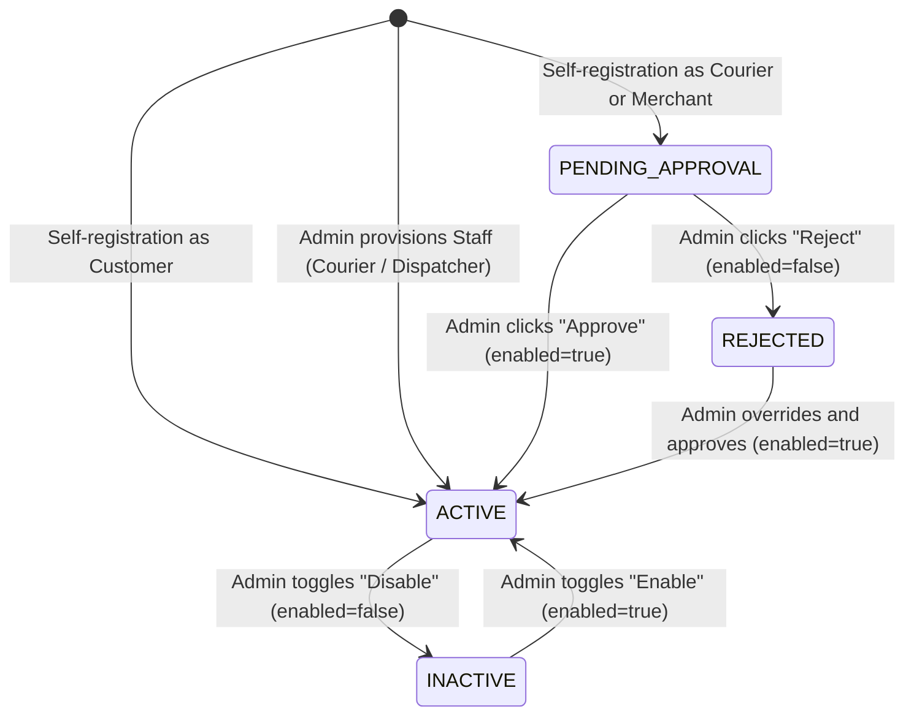

# SwiftDrop Platform Technical Report: Google OAuth 2.0 Social Login & Role Verification Architecture

**Project:** SwiftDrop Enterprise Logistics & Parcel Delivery Platform  
**Module:** Member M2 (Sadeepa) & Member M8 (Security & Foundation)  
**Date:** November 18, 2026  
**Document Classification:** Technical Architecture & Compliance Report  

---

## Executive Summary

The SwiftDrop platform implements an enterprise-grade identity and access management (IAM) subsystem designed to handle high-throughput customer logistics, commercial merchant storefronts, delivery fleet operations, dispatch coordination, and central administration. 

To provide a seamless, secure onboarding experience while preventing identity spoofing and privilege escalation, the platform couples **Google OAuth 2.0 Social Login (Authorization Code Grant with OpenID Connect)** with a **Multi-Tier Role-Based Access Control (RBAC) and Administrative Verification Engine**.

Key accomplishments of this implementation include:
1. **Confidential Client OAuth 2.0 Flow:** Client secrets (`GOOGLE_CLIENT_SECRET`) never reach the browser or client bundle. All code-to-token exchanges occur over encrypted backchannel connections between the Spring Boot gateway and Google identity endpoints.
2. **Defensive Anti-CSRF Protection:** State parameter nonces and short-lived HTTP-only cookies prevent Login Cross-Site Request Forgery (CSRF) and session fixation attacks.
3. **Role Whitelisting & Privilege Escalation Defense:** Incoming OAuth parameters are strictly filtered against allowed self-registration roles (`CUSTOMER`, `MERCHANT`, `COURIER`). Privileged roles (`ADMIN`, `DISPATCHER`) cannot be self-selected or injected via query tampering.
4. **Partner KYC & Pending Admin Approval Hold:** While standard customers receive immediate access, specialized partner roles (`MERCHANT` and `COURIER`) enter a `PENDING_APPROVAL` hold. The system denies JWT issuance until an administrator inspects applicant credentials (business registration or courier KYC documents) and formally approves the account.
5. **Unified Stateless Token Architecture:** Third-party Google identities are normalized into internal SwiftDrop entities and issued signed, time-bounded HMAC-SHA256 JSON Web Tokens (JWTs).
6. **Cross-Tab Session Synchronization:** The React frontend utilizes browser `storage` event listeners to prevent multi-tab session drift, role desynchronization, or stale permission states.

---

## 1. System Architecture & Component Overview

```
                      +---------------------------------------+
                      |          Customer / Partner           |
                      |        Browser / React Client         |
                      +-------------------+-------------------+
                                          |
                        HTTPS (TLS 1.3)   |  Authorization / Callback
                                          v
                      +-------------------+-------------------+
                      |      Spring Boot Security Gateway     |
                      |   - CustomOAuth2RequestResolver       |
                      |   - OAuth2LoginAuthenticationFilter   |
                      |   - OAuth2AuthenticationSuccessHandler|
                      |   - JwtTokenAuthenticationFilter      |
                      +---------+-------------------+---------+
                                |                   |
             Backchannel POST   |                   | Direct JPA Access
             OIDC Token Verify  |                   |
                                v                   v
                     +----------+----+     +--------+--------+
                     | Google Auth   |     | PostgreSQL DB   |
                     | Servers (JWKS)|     | (Users, Roles,  |
                     +---------------+     |  Merchants,     |
                                           |  Couriers)      |
                                           +-----------------+
```

### Key Components

| Component | Layer / Location | Core Responsibility |
| :--- | :--- | :--- |
| `GoogleLoginButton.tsx` | Frontend (`src/features/auth`) | Triggers OAuth initiation; transmits selected self-registration role (`CUSTOMER`, `MERCHANT`, `COURIER`) via query parameters. |
| `CustomOAuth2AuthorizationRequestResolver.java` | Backend (`com.swiftdrop.auth.security`) | Intercepts authorization requests, validates requested role against strict whitelist, and stores role in HTTP session & short-lived HTTP-only cookie. |
| `SecurityConfig.java` | Backend (`com.swiftdrop.common.config`) | Defines Spring Security filter chains (`merchantApiFilterChain`, `apiFilterChain`, `browserFilterChain`), stateless session policy, and OAuth2 login handlers. |
| `OAuth2AuthenticationSuccessHandler.java` | Backend (`com.swiftdrop.auth.security`) | Handles Google OIDC authentication success: validates verified email, auto-provisions or links user accounts, enforces approval holds, creates merchant records, and issues JWT tokens. |
| `JwtService.java` / `JwtTokenProvider.java` | Backend (`com.swiftdrop.auth.security` / `com.swiftdrop.security`) | Generates and cryptographically validates HS256-signed application JWTs encoding identity and role claims. |
| `JwtTokenAuthenticationFilter.java` | Backend (`com.swiftdrop.security`) | Intercepts all API requests, parses Bearer tokens, extracts claims, and populates Spring `SecurityContextHolder`. |
| `AdminUserController.java` | Backend (`com.swiftdrop.auth.api`) | Admin-only API (`@PreAuthorize("hasRole('ADMIN')")`) for user directory queries, KYC inspection, role updates, account activation/suspension, and staff creation. |
| `OAuthCallbackPage.tsx` | Frontend (`src/features/auth`) | Handles redirection from backend callback, captures JWT token, handles `PendingAdminApproval`, and routes users to role dashboards. |
| `ProtectedRoute.tsx` | Frontend (`src/components`) | Enforces role boundaries on routes, redirecting unauthenticated or pending users to `/login`, `/select-role`, or `/waiting-approval`. |
| `ApprovalReviewPage.tsx` | Frontend (`src/features/admin/pages`) | Dedicated administrative portal for inspecting merchant details or courier KYC documents (NIC cards, vehicle data) with approve/reject actions. |

---

## 2. Google OAuth 2.0 Social Login Flow

### 2.1 Complete Authentication Sequence

```mermaid
sequenceDiagram
    autonumber
    actor User as User (Browser)
    participant FE as React Frontend (/login or /signup)
    participant Gateway as Spring Security Gateway
    participant Google as Google Identity Server
    participant Handler as OAuth2AuthenticationSuccessHandler
    participant DB as PostgreSQL Database
    participant JWT as JwtService
    participant Callback as React (/oauth/callback)

    User->>FE: Click "Continue with Google" (Optional: role=MERCHANT)
    FE->>Gateway: GET /oauth2/authorization/google?role=MERCHANT
    Note over Gateway: CustomOAuth2AuthorizationRequestResolver:<br/>1. Validates role in whitelist (CUSTOMER, MERCHANT, COURIER)<br/>2. Sets anti-CSRF state token<br/>3. Sets swiftdrop_oauth2_role HTTP-only cookie
    Gateway-->>User: 302 Redirect to accounts.google.com/o/oauth2/v2/auth

    User->>Google: Authenticate & Consent (Scopes: openid, email, profile)
    Google-->>Gateway: 302 Redirect to /login/oauth2/code/google?code=AUTH_CODE&state=STATE_NONCE

    rect rgb(30, 41, 59)
        Note over Gateway,Google: Backchannel Cryptographic Validation
        Gateway->>Gateway: Verify returned state matches session cookie (Anti-CSRF)
        Gateway->>Google: POST https://oauth2.googleapis.com/token (code + GOOGLE_CLIENT_SECRET)
        Google-->>Gateway: 200 OK (id_token, access_token)
        Gateway->>Gateway: Verify ID token digital signature via Google JWKS
    end

    Gateway->>Handler: onAuthenticationSuccess(request, response, authentication)
    Note over Handler: Step 1: Verify email_verified == true<br/>Step 2: Extract email, name, sub

    Handler->>DB: findByEmail(googleEmail)

    alt Account Exists (Enabled = false or Status = INACTIVE/REJECTED)
        DB-->>Handler: User Entity (Disabled)
        Handler-->>User: 302 Redirect to /login?error=account_disabled
    else Account Exists (Status = PENDING_APPROVAL)
        DB-->>Handler: User Entity (Pending)
        Handler-->>User: 302 Redirect to /oauth/callback?error=PendingAdminApproval
    else Account Exists & Active (Link Account)
        DB-->>Handler: User Entity (Active)
        Handler->>DB: UPDATE users SET provider='GOOGLE', provider_id=googleSub
        Handler->>JWT: generateToken(userId, email, fullName, role, status)
        JWT-->>Handler: Signed JWT
        Handler-->>User: 302 Redirect to /oauth/callback?token=JWT
    else New Account - Role = CUSTOMER (Instant Access)
        DB-->>Handler: Optional.empty()
        Handler->>DB: INSERT INTO users (email, role='ROLE_CUSTOMER', provider='GOOGLE', status='ACTIVE', enabled=true)
        Handler->>JWT: generateToken(userId, email, fullName, 'ROLE_CUSTOMER', 'ACTIVE')
        JWT-->>Handler: Signed JWT
        Handler-->>User: 302 Redirect to /oauth/callback?token=JWT&newUser=true
    else New Account - Role = MERCHANT or COURIER (Approval Required)
        DB-->>Handler: Optional.empty()
        Handler->>DB: INSERT INTO users (email, role=ROLE, provider='GOOGLE', status='PENDING_APPROVAL', enabled=false)
        opt Role == MERCHANT
            Handler->>DB: INSERT INTO merchants (user_id, status='PENDING', business_name=...)
        end
        Handler-->>User: 302 Redirect to /oauth/callback?error=PendingAdminApproval
    end

    Callback->>Callback: Parse token or error query parameters
    alt Has Valid Token
        Callback->>Callback: persistAuth(token, user), update AuthContext
        Callback-->>User: Navigate to Role Dashboard (e.g., /dashboard, /merchant/orders)
    else Error == PendingAdminApproval
        Callback-->>User: Navigate to /waiting-approval
    end
```



### 2.2 Detailed Step-by-Step Walkthrough

#### Step 1: Login Initiation & Role Propagation
The user clicks the **"Continue with Google"** button on the login page or chooses a specific role on the registration page (`/signup`):
- If the user clicked from a role-specific sign-up card, `GoogleLoginButton.tsx` records the requested role in `sessionStorage` and attaches `?role={role}` to the authorization URL:
  ```typescript
  window.location.href = `/oauth2/authorization/google?role=${encodeURIComponent(role)}`;
  ```
- If the user clicks on the general login page, no role parameter is sent, defaulting to standard account login or `CUSTOMER` provisioning.

#### Step 2: Resolver Interception & Cookie Capture
Spring Security's default resolver is replaced by `CustomOAuth2AuthorizationRequestResolver`:
- Intercepts requests targeting `/oauth2/authorization/google`.
- Extracts `role` from request parameters.
- Validates the role using `Role.normalizeOrDefault(roleParam, null)`. Only `CUSTOMER`, `MERCHANT`, and `COURIER` are accepted. Any attempt to supply `ADMIN` or `DISPATCHER` is dropped with a security audit warning.
- Stores the validated role in both the server-side `HttpSession` (`SWIFTDROP_OAUTH2_ROLE`) and an HTTP-only cookie (`swiftdrop_oauth2_role`, Max-Age: 300s).
- Generates a cryptographically random `state` nonce and issues a `302 Redirect` to Google’s OAuth 2.0 authorization endpoint.

#### Step 3: Google Identity Consent
The user authenticates with Google and grants consent for scopes:
- `openid`: Standard OpenID Connect subject identification.
- `email`: User email address.
- `profile`: Full name and avatar.

#### Step 4: Backchannel Code Exchange & Verification
Google redirects the browser to SwiftDrop’s registered callback:
`GET /login/oauth2/code/google?code={authorizationCode}&state={stateNonce}`
1. **CSRF Validation:** Spring Security compares the returned `state` against the encrypted session cookie.
2. **Backchannel Token Exchange:** The server makes a secure HTTPS `POST` call directly to `https://oauth2.googleapis.com/token` carrying the authorization code, client ID, and `GOOGLE_CLIENT_SECRET`.
3. **ID Token Signature Verification:** Google returns an OIDC ID Token and an Access Token. Spring Security fetches Google's public JWKS keys from `https://www.googleapis.com/oauth2/v3/certs` and verifies the digital signature, issuer (`accounts.google.com`), and expiration.

#### Step 5: Success Handler Processing (`OAuth2AuthenticationSuccessHandler`)
The application executes defensive checks:
1. **Email Authority Verification:**
   ```java
   Boolean emailVerified = oAuth2User.getAttribute("email_verified");
   if (Boolean.FALSE.equals(emailVerified)) {
       getRedirectStrategy().sendRedirect(request, response, loginErrorUrl("email_not_verified"));
       return;
   }
   ```
2. **Mandatory Identity Claims:** Ensures `email` is present and non-blank; otherwise redirects to `/login?error=missing_email`.
3. **Account Status Check:**
   - If the account exists and is deactivated (`enabled == false` or `status IN ('INACTIVE', 'REJECTED')`), access is immediately denied: `/login?error=account_disabled`.
   - If the account is pending approval (`status == 'PENDING_APPROVAL'`), redirects to `/oauth/callback?error=PendingAdminApproval`. No JWT is minted.
4. **Account Linking:**
   - If an active local account exists with the same email, it links the account (`provider = 'GOOGLE'`, `provider_id = googleSub`), preserving existing roles and data.
5. **New Account Provisioning:**
   - Retrieves the captured role from the cookie or session.
   - For `ROLE_CUSTOMER`: Account is set to `status = 'ACTIVE'`, `enabled = true`. Mints a signed SwiftDrop JWT and redirects to `/oauth/callback?token={jwt}&newUser=true`.
   - For `ROLE_MERCHANT` or `ROLE_COURIER`: Account is set to `status = 'PENDING_APPROVAL'`, `enabled = false`. A pending merchant entity is automatically seeded in `merchants`. No JWT is issued, and the user is redirected to `/oauth/callback?error=PendingAdminApproval`.

#### Step 6: Frontend Handover & Session Storage
On `/oauth/callback`:
- The page removes temporary registration markers from `sessionStorage`.
- If `error === 'PendingAdminApproval'`, navigates directly to `/waiting-approval`.
- If `token` is present:
  - Decodes token claims (`decodeJwt`).
  - Saves token and user model to `localStorage` or `sessionStorage` (`TOKEN_KEY = "swiftdrop_access_token"`).
  - Initializes `AuthContext`.
  - Dispatches navigation to the role portal:
    - `ADMIN` $\rightarrow$ `/admin/overview`
    - `DISPATCHER` $\rightarrow$ `/fleet`
    - `COURIER` $\rightarrow$ `/courier/today`
    - `MERCHANT` $\rightarrow$ `/merchant/orders`
    - `CUSTOMER` $\rightarrow$ `/dashboard`

---

## 3. Role Verification & RBAC Architecture

### 3.1 Role Hierarchy & Permissions Matrix

SwiftDrop defines five distinct roles in `Role.java`:

| Role | Self-Registerable? | Approval Required? | Default Landing Route | Primary Capabilities |
| :--- | :---: | :---: | :--- | :--- |
| `ROLE_CUSTOMER` | **Yes** | No (Instant) | `/dashboard` | Book deliveries, manage personal address book, view parcel tracking history, download PDF receipts. |
| `ROLE_MERCHANT` | **Yes** | **Yes (Admin)** | `/merchant/orders` | Bulk parcel shipment, manage automated merchant store API keys, store fulfillment webhooks. |
| `ROLE_COURIER` | **Yes** | **Yes (Admin)** | `/courier/today` | View daily assigned delivery manifest, update delivery milestones, upload Proof of Delivery (POD). |
| `ROLE_DISPATCHER` | **No** (Staff Only) | N/A (Admin Created) | `/fleet` | Fleet tracking, zone management, manual & automatic courier dispatch assignment, incident alerts. |
| `ROLE_ADMIN` | **No** (Pre-seeded) | N/A (Owner / Root) | `/admin/overview` | Complete system governance, user directory management, staff provisioning, pricing controls, audit logs. |

### 3.2 Account Status Lifecycle



1. **`ACTIVE`:** User can log in, receive JWTs, and access authorized endpoints.
2. **`PENDING_APPROVAL`:** User registration received; account is locked (`enabled = false`). Login attempts redirect to the waiting approval screen; no token is issued.
3. **`PENDING_ROLE`:** Edge-case state where an OAuth account exists without an assigned role; user is routed to `/select-role`.
4. **`REJECTED`:** Administrator rejected the KYC verification; account is disabled. Rejection reason is recorded for audit purposes.
5. **`INACTIVE`:** Administrator suspended the account. Any attempt to authenticate via password or Google login produces an `account_disabled` error.

### 3.3 Backend Role Enforcement

1. **Stateless JWT Authorization Filter (`JwtTokenAuthenticationFilter`):**
   - Extracts the `Bearer` token from the HTTP `Authorization` header.
   - Verifies the cryptographic HMAC-SHA256 signature using the secret key (`Keys.hmacShaKeyFor(secret)`).
   - Extracts `userId`, `email`, and `role`.
   - Maps role strings to Spring Security `SimpleGrantedAuthority` (ensuring `ROLE_` prefix normalization).
   - Populates the thread-local `SecurityContextHolder`.

2. **Method-Level Security (`@PreAuthorize`):**
   - Enabled via `@EnableMethodSecurity` in `SecurityConfig`.
   - All admin endpoints under `AdminUserController` are locked:
     ```java
     @RestController
     @RequestMapping("/api/v1/admin/users")
     @PreAuthorize("hasRole('ADMIN')")
     public class AdminUserController { ... }
     ```
   - Attempted access by non-admin tokens triggers a `403 Forbidden` caught by `RestAccessDeniedHandler`.

3. **Insecure Direct Object Reference (IDOR) Protection:**
   - Ownership validation in `ReceiptController`: Only the customer who owns the parcel (`parcel.customerId == user.id`) or a system administrator (`ADMIN`) can download delivery receipts.

### 3.4 Frontend Role Enforcement & Cross-Tab Synchronization

1. **Route Guarding (`ProtectedRoute.tsx`):**
   ```tsx
   export function ProtectedRoute({ allowedRoles }: { allowedRoles?: Role[] }) {
     const { user } = useAuth();
     if (!user) return <Navigate to="/login" replace />;
     if (user.status === "PENDING_ROLE") return <Navigate to="/select-role" replace />;
     if (user.status === "PENDING_APPROVAL") return <Navigate to="/waiting-approval" replace />;
     if (allowedRoles && !allowedRoles.includes(user.role)) return <Navigate to="/dashboard" replace />;
     return <Outlet />;
   }
   ```
2. **Cross-Tab Session Synchronization (`AuthContext.tsx`):**
   - Listens to browser `window.addEventListener("storage", handleStorageChange)`.
   - When an administrator or user switches accounts or logs out in Tab A:
     - Tab B intercepts the event on `TOKEN_KEY` / `USER_KEY`.
     - Automatically synchronizes memory state.
     - Re-evaluates permissions and auto-redirects the secondary tab to the matching role portal or `/login`, preventing privilege drift or stale execution.

---

## 4. Partner Verification & KYC Approval Engine

### 4.1 Courier & Merchant Onboarding

Specialized platform roles require regulatory KYC verification before accessing customer packages, delivery routes, or high-volume payment processing:

* **Merchant Verification:**
  - On Google sign-in with `role=MERCHANT`, a pending `Merchant` record is created with business name, registration number, and contact details.
  - The record is marked with status `MerchantStatus.PENDING`.
* **Courier Verification:**
  - Courier applicants complete a comprehensive verification application (`/courier/register`) submitting National Identity Card (NIC) details, front and back photos of their NIC, vehicle registration plate, driving license number and expiration date, and emergency contact details.
  - Documents are stored in secure uploads with access restricted to administrators.

### 4.2 Administrator Verification Workflow (`ApprovalReviewPage.tsx`)

Administrators navigate to `/admin/users` or `/admin/users/:id/review`:
1. **Applicant Inspection:** The admin views complete applicant records, including contact numbers, registration dates, vehicle specifications, and linked merchant details.
2. **Secure Document Rendering (`ProtectedDocumentImage`):**
   - Courier NIC and license images are retrieved via authenticated backend blob endpoints (`/api/v1/courier/documents/...`), preventing public URL exposure or indexing.
3. **Approval Action (`PATCH /api/v1/admin/users/{id}/approve`):**
   - Sets user `status = 'ACTIVE'`, `enabled = true`.
   - Sets linked merchant `status = MerchantStatus.APPROVED`.
   - Sets linked courier profile `active = true`.
4. **Rejection Action (`PATCH /api/v1/admin/users/{id}/reject`):**
   - Sets user `status = 'REJECTED'`, `enabled = false`.
   - Persists administrative rejection reason (e.g., "Expired driving license" or "Illegible NIC photo").

### 4.3 Real-Time Approval Polling (`WaitingApprovalPage.tsx`)

Users placed on approval hold remain on the waiting screen:
- Displays applicant name, email, and requested role badge.
- Provides a **"Check Approval Status"** button calling `/api/v1/users/me`.
- Upon admin approval, the response returns `status = "ACTIVE"`, shows an approval banner, and automatically navigates the user to their designated dashboard.

---

## 5. Security & Threat Mitigation Matrix

| Security Threat | OWASP Category | Attack Vector | Implemented Mitigation |
| :--- | :--- | :--- | :--- |
| **Login CSRF / Session Injection** | A08: Software & Data Integrity Failures | Attacker tricks victim into clicking a pre-seeded OAuth authorization link to bind victim to attacker's account. | Cryptographically generated random `state` nonce stored in HTTP-only cookie, verified by Spring Security before token exchange. |
| **Privilege Escalation via Parameter Tampering** | A01: Broken Access Control | Attacker intercepts `/oauth2/authorization/google` and injects `role=ADMIN` or `role=DISPATCHER`. | `CustomOAuth2AuthorizationRequestResolver` validates role against `Role.SELF_REGISTERABLE` whitelist; invalid/elevated roles are safely discarded. |
| **Pre-Account Takeover via Unverified Emails** | A07: Identification & Auth Failures | Attacker registers a victim's email on an unverified Google account, attempting to gain access to an existing SwiftDrop profile. | `OAuth2AuthenticationSuccessHandler` checks `email_verified == true`. Accounts with unverified emails are immediately rejected. |
| **Bypassing Account Suspension** | A07: Identification & Auth Failures | Suspended or deactivated user attempts to log in using Google OAuth to circumvent password login block. | System checks `enabled == false` and status (`INACTIVE` / `REJECTED`) during OAuth success handling, redirecting to `/login?error=account_disabled`. |
| **Cross-Tab Session Drift / Role Hijack** | A04: Insecure Design | User switches roles or logs out in one tab while another tab executes actions with stale cached credentials. | Frontend `AuthContext` listens to browser `storage` events, instantly synchronizing tokens and re-routing across all active tabs. |
| **Secret Leakage in Client Bundles** | A05: Security Misconfiguration | Committing or exposing `GOOGLE_CLIENT_SECRET` in single-page application client code. | Secrets reside strictly in backend `.env` variables; token exchange is handled exclusively via backchannel server-to-server calls. |
| **Insecure Direct Object Reference (IDOR)** | A01: Broken Access Control | Authenticated Customer A attempts to view or download Customer B's PDF delivery receipt or address book. | `ReceiptController` and `AddressController` enforce strict ownership checks (`parcel.customerId == user.id`). Unauthorized requests receive `403 Forbidden`. |

---

## 6. Automated Test Suite & Quality Assurance

The Google login and role verification implementation is supported by **over 38 automated test cases** across backend and frontend suites with zero regressions:

### 6.1 Backend Test Cases (`OAuth2AuthenticationSuccessHandlerTest.java`)

| Test ID | Test Method | Test Scenario | Verified Assertion |
| :--- | :--- | :--- | :--- |
| **TC-SEC-01** | `newUser_defaultsToCustomerAndRedirectsWithJwt` | First-time Google user with no specified role. | Created with `ROLE_CUSTOMER`, `status = ACTIVE`, `enabled = true`; receives signed JWT redirect. |
| **TC-SEC-02** | `newCourierUser_createsPendingAccountAndRedirectsWithoutJwt` | First-time Google user requesting `COURIER` role. | Created with `ROLE_COURIER`, `status = PENDING_APPROVAL`, `enabled = false`; redirected to `PendingAdminApproval`; no JWT issued. |
| **TC-SEC-03** | `newMerchantUser_createsPendingAccountAndRedirectsWithoutJwt` | First-time Google user requesting `MERCHANT` role via cookie. | Created with `ROLE_MERCHANT`, `status = PENDING_APPROVAL`, `enabled = false`; merchant profile created; redirected without JWT. |
| **TC-SEC-04** | `disallowedRoleRequested_defaultsToCustomer` | Malicious user passes `?role=ADMIN` in OAuth parameters. | Escalation rejected; role falls back to `ROLE_CUSTOMER`; account activated normally. |
| **TC-SEC-05** | `existingUser_linksGoogleProviderAndPreservesRole` | Existing local courier signs in via Google OAuth. | Links provider to `GOOGLE`, stores `providerId`; preserves `ROLE_COURIER`; generates JWT with courier claims. |
| **TC-SEC-06** | `existingPendingUser_redirectsWithPendingAdminApproval` | Existing pending courier attempts to log in again. | User detected in `PENDING_APPROVAL`; token issuance withheld; redirected to `PendingAdminApproval`. |
| **TC-SEC-07** | `unverifiedEmail_redirectsToLoginWithError` | Google account has `email_verified: false`. | Login aborted; user entity not created; redirected to `/login?error=email_not_verified`. |
| **TC-SEC-08** | `missingEmail_redirectsToLoginWithError` | Google payload contains null or empty email. | Login aborted; redirected to `/login?error=missing_email`. |
| **TC-SEC-09** | `disabledAccount_redirectsToLoginWithError` | Suspended account (`enabled = false`) attempts Google login. | Access rejected; redirected to `/login?error=account_disabled`. |

### 6.2 Frontend Test Cases (`RoleSelectionPage.test.tsx` & `WaitingApprovalPage.test.tsx`)

| Test ID | Suite | Test Scenario | Verified Assertion |
| :--- | :--- | :--- | :--- |
| **TC-FE-01** | `RoleSelectionPage` | Role presentation and options rendering. | Only `Customer`, `Merchant`, and `Courier` are displayed; `Admin` and `Dispatcher` are strictly excluded from UI. |
| **TC-FE-02** | `RoleSelectionPage` | Customer role selection submission. | Invokes `selectRole('CUSTOMER')` and navigates user to `/dashboard`. |
| **TC-FE-03** | `RoleSelectionPage` | Merchant/Courier role selection submission. | Invokes `selectRole('MERCHANT')` and navigates user to `/waiting-approval`. |
| **TC-FE-04** | `WaitingApprovalPage` | Pending approval holding card. | Displays review heading, status badge, and user email. |
| **TC-FE-05** | `WaitingApprovalPage` | Status check on approved account. | Invokes `refreshProfile()`; upon receiving `ACTIVE`, displays success confirmation and navigates to `/dashboard`. |
| **TC-FE-06** | `WaitingApprovalPage` | Session sign-out. | Invokes `logout()`, clears storage, and redirects to `/login`. |

---

## 7. Configuration & Environment Variables Reference

To run the Google OAuth 2.0 flow locally or in containerized staging:

```bash
# Google Cloud OAuth 2.0 Client Credentials (GCP Console -> APIs & Services -> Credentials)
GOOGLE_CLIENT_ID=your-google-client-id.apps.googleusercontent.com
GOOGLE_CLIENT_SECRET=your-google-client-secret
GOOGLE_REDIRECT_URI=http://localhost:8080/login/oauth2/code/google

# Application JWT Configuration
JWT_SECRET=c3dpZnRkcm9wLXNlY3VyZS1qd3Qtc2VjcmV0LWtleS0yMDI2LXN3aWZ0ZHJvcC1sb2dpc3RpY3M=
JWT_EXPIRATION_MS=86400000          # 24 hours
JWT_REFRESH_EXPIRATION_MS=604800000  # 7 days

# Frontend Base URL (for OAuth redirection)
FRONTEND_BASE_URL=http://localhost:5173
```

