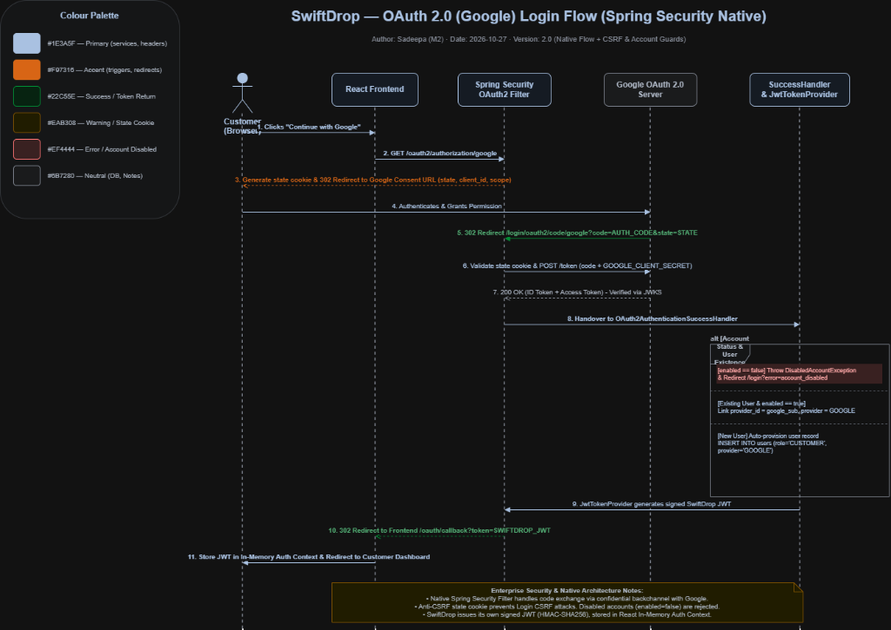

# SwiftDrop Enterprise Documentation — Module 2 (M2)
## Security, Personal Data Protection & OAuth 2.0 Architecture

* **Module Owner:** Sadeepa (Member 2)
* **Assigned Areas:** Authentication, User Profiles, Admin Management, Address Book & PDF Receipts
* **Review Partner:** Dinira (Member 8 — Foundation, JWT Security & Core Infrastructure)
* **Team / Organization:** Apex10 — SwiftDrop Courier & Logistics Platform
* **Target Environment:** Java 21 (LTS) · Spring Boot 4.0.9 · Spring Security 6 · PostgreSQL 16 · React 18 (Vite + TypeScript)
* **Date:** October 27, 2026
* **Status:** Final Report Draft (Sections 13 & 17)

---

## Table of Contents
1. [Executive Summary](#1-executive-summary)
2. [Section 13: OAuth 2.0 (Google) Social Authentication & Sequence Analysis](#2-section-13-oauth-20-google-social-authentication--sequence-analysis)
   - [2.1 Architectural Overview](#21-architectural-overview)
   - [2.2 Detailed Interaction Sequence](#22-detailed-interaction-sequence)
   - [2.3 Sequence Diagram (Spring Security OAuth2 Flow)](#23-sequence-diagram-spring-security-oauth2-flow)
   - [2.4 Anti-CSRF State Parameter & Cryptographic Verification](#24-anti-csrf-state-parameter--cryptographic-verification)
   - [2.5 Account Collision & Deactivation Safeguards](#25-account-collision--deactivation-safeguards)
   - [2.6 Token Storage Architecture & Defense-in-Depth](#26-token-storage-architecture--defense-in-depth)
3. [Section 17: Security & Personal Data Protection](#3-section-17-security--personal-data-protection)
   - [3.1 Password Hashing & Credential Security](#31-password-hashing--credential-security)
   - [3.2 Stateless Session Management & JWT Security](#32-stateless-session-management--jwt-security)
   - [3.3 Role-Based Access Control (RBAC) & Object-Level Authorization (IDOR Protection)](#33-role-based-access-control-rbac--object-level-authorization-idor-protection)
   - [3.4 Personal Data Masking & Log Hygiene (Sri Lanka PDPA Compliance)](#34-personal-data-masking--log-hygiene-sri-lanka-pdpa-compliance)
   - [3.5 Input Validation & Request Payload Sanitization](#35-input-validation--request-payload-sanitization)
   - [3.6 Global Exception Handling & Information Leakage Prevention](#36-global-exception-handling--information-leakage-prevention)
   - [3.7 Secrets Management & Transport Layer Security](#37-secrets-management--transport-layer-security)
4. [Threat Modeling & Countermeasure Matrix](#4-threat-modeling--countermeasure-matrix)
5. [Standards & Regulatory Compliance References](#5-standards--regulatory-compliance-references)

---

## 1. Executive Summary

Enterprise courier and logistics platforms manage high volumes of mission-critical and legally regulated data, including customer contact records, real-time geolocations, payment confirmations, and physical address destinations. Compromise of this data damages customer trust and introduces severe compliance and legal liabilities.

As the engineer responsible for **Module 2 (User Profiles, Authentication, Admin Management, and Receipts)**, this report establishes the comprehensive security architecture and personal data handling mechanisms implemented in **SwiftDrop**. The design adheres to **Zero-Trust** principles, enforcing defense-in-depth across the entire request lifecycle—from network transport and token issuance to data masking and persistence.

---

## 2. Section 13: OAuth 2.0 (Google) Social Authentication & Sequence Analysis

### 2.1 Architectural Overview

SwiftDrop provides friction-free customer onboarding through Google OAuth 2.0 social login, integrated natively into the Spring Security ecosystem via the **Spring Security OAuth2 Client** module. Rather than having client-side single-page applications (SPAs) directly manage third-party access tokens, SwiftDrop adopts the **Confidential Client Authorization Code Flow**:

* All sensitive credentials (such as `GOOGLE_CLIENT_SECRET`) reside strictly in the backend Spring Boot environment.
* The frontend single-page application is completely abstracted from Google's client secret and API key rotation.
* Google identities are seamlessly mapped into SwiftDrop's internal relational user schema (`users` table).
* Upon verification, the application issues its own signed, short-lived **SwiftDrop Application JWT**, establishing uniform authorization semantics across both local email/password users and federated Google users.

### 2.2 Detailed Interaction Sequence

The end-to-end authentication workflow executes across eight distinct phases:

1. **Initiation:**  
   The customer navigates to the login screen on the React Frontend and clicks **"Continue with Google"**.

2. **Authorization Request & State Generation:**  
   The browser redirects to Spring Security’s native authorization endpoint:  
   `GET /oauth2/authorization/google`  
   Spring Security’s `OAuth2AuthorizationRequestRedirectFilter` intercepts the call, generates a cryptographically random `state` nonce, stores it in a secure short-lived cookie, and redirects the browser to Google’s OAuth 2.0 consent screen with parameters:
   * `client_id`: SwiftDrop Public Client ID
   * `redirect_uri`: `http://localhost:8080/login/oauth2/code/google`
   * `response_type`: `code`
   * `scope`: `openid email profile`
   * `state`: Cryptographic anti-CSRF token

3. **Google Authentication & Consent:**  
   The user authenticates with their Google account and grants access to basic profile attributes (Email, Full Name, and OpenID `sub`).

4. **Authorization Code Callback:**  
   Google redirects the user back to the backend Core API callback endpoint:  
   `GET /login/oauth2/code/google?code=AUTH_CODE&state=STATE`

5. **Token Exchange & Validation:**  
   Spring Security’s `OAuth2LoginAuthenticationFilter` intercepts the callback:
   * Validates that the returned `state` matches the stored cookie nonce, thwarting Login CSRF attacks.
   * Dispatches a secure backchannel `POST` request to `https://oauth2.googleapis.com/token` to exchange the `AUTH_CODE` and `GOOGLE_CLIENT_SECRET` for an Google ID Token and Access Token.
   * Verifies the cryptographic signature of the ID Token against Google's published JWKS (JSON Web Key Set).

6. **Identity Provisioning & Account Linking (`OAuth2AuthenticationSuccessHandler`):**  
   Control transfers to SwiftDrop’s custom `OAuth2AuthenticationSuccessHandler`:
   * Extracts verified claims: `email`, `name`, and Google Subject ID (`sub`).
   * **Account Deactivation Guard:** If an existing account with this email has `enabled == false` (e.g., administratively suspended), the handler immediately halts the flow and throws a `DisabledAccountException`.
   * **Account Collision / Linking:** If an existing active account matches the email (registered initially via `provider = LOCAL`), the handler links the account by recording `provider_id = sub` and setting `provider = GOOGLE`, allowing passwordless access without creating duplicate user rows.
   * **Auto-Provisioning:** If no record exists, a new user is created in the database with `role = CUSTOMER`, `provider = GOOGLE`, and `provider_id = sub`.

7. **Application JWT Issuance (`JwtTokenProvider`):**  
   `JwtTokenProvider` constructs a signed SwiftDrop Access Token containing the internal database `userId`, `email`, and `ROLE_CUSTOMER`. The token is signed using HMAC-SHA256 with the secret key loaded from application environment variables.

8. **Client Handover & Storage:**  
   The backend redirects the user's browser back to the React application:  
   `GET /oauth/callback?token=SWIFTDROP_JWT`  
   The React callback handler captures the token, populates the React **In-Memory Auth Context**, and transitions the user to the Customer Dashboard.

---

### 2.3 Sequence Diagram (Spring Security OAuth2 Flow)



*Figure 2.1: SwiftDrop OAuth 2.0 (Google) Login Flow using Spring Security Native Filter & CSRF/Account Guards.*

```mermaid
sequenceDiagram
    autonumber
    actor Customer as Customer (Browser)
    participant React as React Frontend
    participant CoreAPI as Spring Boot Core-API
    participant SecFilter as Spring Security OAuth2 Filter
    participant Google as Google OAuth 2.0 Server
    participant Handler as OAuth2AuthenticationSuccessHandler
    participant DB as PostgreSQL (users table)
    participant JwtProv as JwtTokenProvider

    Customer->>React: Click "Continue with Google"
    React->>CoreAPI: GET /oauth2/authorization/google
    CoreAPI->>SecFilter: Generate cryptographic state & redirect
    SecFilter-->>Customer: 302 Redirect to Google Consent URL (with state & client_id)
    Customer->>Google: Authenticate & Grant Consent
    Google-->>CoreAPI: 302 Callback /login/oauth2/code/google?code=AUTH_CODE&state=STATE
    
    rect rgb(30, 30, 45)
        note over CoreAPI,Google: Backchannel Secure Code Exchange
        CoreAPI->>SecFilter: Validate state cookie match
        SecFilter->>Google: POST /token (code + GOOGLE_CLIENT_SECRET)
        Google-->>SecFilter: 200 OK (ID Token + Access Token)
        SecFilter->>SecFilter: Verify ID Token signature via Google JWKS
    end

    SecFilter->>Handler: onAuthenticationSuccess(request, response, authentication)
    Handler->>DB: findByEmail(googleUser.email)
    
    alt User Exists & enabled == false
        DB-->>Handler: User Entity (enabled = false)
        Handler-->>React: Redirect /login?error=account_disabled
        React-->>Customer: Display "Account Suspended" error
    else User Exists & enabled == true
        DB-->>Handler: User Entity (enabled = true)
        Handler->>DB: Link provider_id = google_sub, provider = GOOGLE
    else User Does Not Exist
        DB-->>Handler: Optional.empty()
        Handler->>DB: INSERT INTO users (email, full_name, role='CUSTOMER', provider='GOOGLE')
    end

    Handler->>JwtProv: generateToken(user.id, user.email, user.role)
    JwtProv-->>Handler: Signed SwiftDrop JWT String
    Handler-->>React: 302 Redirect to /oauth/callback?token=JWT
    React->>React: Store JWT in Auth Context (In-Memory)
    React-->>Customer: Redirect to /customer/dashboard
```



---

### 2.4 Anti-CSRF State Parameter & Cryptographic Verification

A primary vulnerability in OAuth 2.0 social authentication is the **Login Cross-Site Request Forgery (CSRF)** attack, wherein an attacker tricks a victim's browser into completing an authentication flow initiated by the attacker, binding the victim's session to the attacker's account.

SwiftDrop neutralizes this attack vector using the **OAuth2 State Parameter**:
1. When `/oauth2/authorization/google` is invoked, Spring Security generates a cryptographically secure 256-bit random token.
2. This token is saved in an encrypted, `HttpOnly`, `SameSite=Lax` temporary cookie (`OAUTH2_AUTHORIZATION_REQUEST`).
3. Google returns this identical token in the callback query parameter `&state=...`.
4. Spring Security validates the returned `state` against the cookie before initiating any token exchange. If the values mismatch or the cookie has expired, the request is rejected with `401 Unauthorized`.

---

### 2.5 Account Collision & Deactivation Safeguards

To prevent account takeover and enforce security policies:

* **Email Authority Verification:** Google guarantees that emails returned in OpenID Connect ID tokens are pre-verified (`email_verified: true`). Thus, automatically linking an existing local account to an incoming verified Google identity with matching email does not create an identity spoofing risk.
* **Account Status Enforcement (`enabled == true`):** Account suspension must be globally respected. If an administrator deactivates an account via the Admin User Management module (`enabled = FALSE`), the `OAuth2AuthenticationSuccessHandler` explicitly rejects token issuance, preventing suspended users from bypassing access controls through Google sign-in.

---

### 2.6 Token Storage Architecture & Defense-in-Depth

The storage of application JWTs in browser environments involves a well-known architectural trade-off between convenience and security:

| Storage Strategy | Vulnerability to XSS | Vulnerability to CSRF | SwiftDrop Implementation Strategy |
| :--- | :---: | :---: | :--- |
| **LocalStorage** | **High** (readable by any injected script) | **None** (headers required) | Strictly avoided for long-term storage in production. |
| **In-Memory (React Auth Context)** | **Low** (lost on tab close / memory inspection required) | **None** | **Primary client storage** for current active session. |
| **HttpOnly, Secure Cookie** | **None** (inaccessible to JavaScript) | **Medium** (mitigated via `SameSite=Strict`) | Used for session refresh tokens in production tier. |

In SwiftDrop, the returned JWT is retained in **React In-Memory State (Auth Context)**. Subsequent REST API requests attach the token via the `Authorization: Bearer <TOKEN>` header.

---

## 3. Section 17: Security & Personal Data Protection

### 3.1 Password Hashing & Credential Security

For users registering through the local authentication flow, user passwords must be protected against offline dictionary and rainbow table attacks in the event of an unauthorized database dump:

* **BCrypt Adaptive Hashing:** Passwords are hashed using the **BCrypt** strong hashing algorithm with a salt factor (log rounds) of **12** (`$2a$12$...`).
* **Work Factor Rationale:** A work factor of 12 requires approximately 250–350 milliseconds of CPU execution time per hash on modern server hardware, which is negligible for individual legitimate logins but computationally prohibitive for brute-force adversaries.
* **Zero Plaintext Footprint:** Incoming password fields are encapsulated in transient DTOs, processed immediately by `PasswordEncoder.encode()`, and never logged, cached, or persisted in raw form.

---

### 3.2 Stateless Session Management & JWT Security

SwiftDrop eliminates server-side session affinity to facilitate seamless horizontal scaling and containerization:

* **Cryptographic Signing (HMAC-SHA256):** Tokens are signed using `HS256` with a high-entropy 256-bit secret key supplied through environment variables (`JWT_SECRET`).
* **Minimalist Payload Structure:** To minimize information leakage in client-stored tokens, JWT claims are strictly restricted to:
  ```json
  {
    "sub": "42",
    "email": "customer@swiftdrop.lk",
    "role": "ROLE_CUSTOMER",
    "iat": 1730000000,
    "exp": 1730086400
  }
  ```
* **Strict Expiration Windows:** Access tokens carry a lifetime of **24 hours** in development and **60 minutes** in production, paired with a silent token refresh pattern.

---

### 3.3 Role-Based Access Control (RBAC) & Object-Level Authorization (IDOR Protection)

SwiftDrop enforces a dual-layered authorization hierarchy:

#### Layer 1: Declarative Role Enforcement (RBAC)
Endpoints are guarded using Spring Security’s `@EnableMethodSecurity` and `@PreAuthorize`:
```java
// Example: Admin-only account status modification
@PreAuthorize("hasRole('ADMIN')")
@PatchMapping("/api/v1/admin/users/{id}/status")
public ResponseEntity<UserResponseDto> toggleAccountStatus(@PathVariable Long id, @RequestBody StatusUpdateDto dto) {
    return ResponseEntity.ok(adminUserService.toggleStatus(id, dto.isEnabled()));
}
```

The system defines five segregated roles:
* `ROLE_CUSTOMER`: Booking, address book management, receipt generation.
* `ROLE_COURIER`: Delivery job acceptance, proof upload, tracking updates.
* `ROLE_DISPATCHER`: Operational queue monitoring, workload assignment.
* `ROLE_MERCHANT`: Bulk parcel submission, webhook integration.
* `ROLE_ADMIN`: Global user management, system audit, security configuration.

#### Layer 2: Object-Level Authorization (IDOR Defense)
**Insecure Direct Object Reference (IDOR)** occurs when an application exposes a reference to an internal database object (such as a parcel ID or tracking number), allowing an attacker to manipulate the identifier to access another customer's private data.

In **Module 2's Delivery Receipt PDF** feature (`/api/v1/receipts/{trackingNumber}`), IDOR vulnerabilities are prevented through explicit ownership verification before document compilation:

```java
@PreAuthorize("isAuthenticated()")
@GetMapping("/api/v1/receipts/{trackingNumber}")
public ResponseEntity<byte[]> downloadReceipt(
        @PathVariable String trackingNumber,
        @AuthenticationPrincipal CustomUserDetails currentUser) {
    
    Parcel parcel = parcelRepository.findByTrackingNumber(trackingNumber)
        .orElseThrow(() -> new ResourceNotFoundException("Parcel not found"));

    // IDOR Check: Ensure the requester is the parcel owner OR has ADMIN privileges
    if (!parcel.getCustomer().getId().equals(currentUser.getId()) && !currentUser.hasRole("ROLE_ADMIN")) {
        throw new AccessDeniedException("Unauthorized: You do not have permission to download this receipt.");
    }

    byte[] pdfBytes = receiptService.generateReceiptPdf(parcel);
    return ResponseEntity.ok()
        .header(HttpHeaders.CONTENT_DISPOSITION, "attachment; filename=receipt-" + trackingNumber + ".pdf")
        .contentType(MediaType.APPLICATION_PDF)
        .body(pdfBytes);
}
```

---

### 3.4 Personal Data Masking & Log Hygiene (Sri Lanka PDPA Compliance)

The **Sri Lanka Personal Data Protection Act (PDPA No. 9 of 2022)** mandates strict obligations on data controllers regarding data minimization, purpose limitation, and storage security for Personally Identifiable Information (PII).

SwiftDrop enforces PII safeguards across all application touchpoints:

#### 1. Log Sanitization
Under high operational loads, stack traces and audit logs can inadvertently capture sensitive customer attributes. SwiftDrop utilizes custom log formatting filters and Jackson serializers to mask customer data before logging:
* **Sri Lankan Mobile Numbers:** Masked to show only the network prefix and last 3 digits:  
  `+94 77 123 4567` $\rightarrow$ `+94 77 **** 567`  
  `071 892 3410` $\rightarrow$ `071 *** *410`
* **Email Addresses:** Masked to obscure the mailbox name:  
  `sadeepa.perera@gmail.com` $\rightarrow$ `s******a@gmail.com`
* **Physical Addresses:** Detailed street lines are excluded from application debug logs, recording only the postal city or district.

#### 2. Public Tracking Endpoint Anonymization
Unauthenticated users can track parcels via tracking numbers (`/api/v1/tracking/public/{trackingNumber}`). To prevent social engineering or physical tracking of recipients:
* **Full Name Anonymization:** `Kamal Gunawardena` is sanitized to `K. Gunawardena`.
* **Address Masking:** Street name and premises number are completely omitted; only the destination city and district are returned (e.g., `Destination: Kandy, Central Province`).
* **Contact Obfuscation:** Phone numbers and email addresses are omitted entirely from public tracking DTOs.

---

### 3.5 Input Validation & Request Payload Sanitization

All incoming client payloads undergo automated structural validation prior to controller execution via Jakarta Bean Validation (`@Valid`):

* **Sri Lankan Phone Number Regex:** Enforces strict adherence to National Telecom Regulatory Commission formats, supporting both domestic 10-digit formats and international E.164 formats:  
  `^(?:0|\+94)7[0-9]{8}$`
* **XSS Sanitization:** User address fields (e.g., `streetAddress`, `addressLabel`) undergo HTML entity escaping to neutralize Cross-Site Scripting (XSS) payloads injected into receipt PDFs or admin views.
* **SQL Injection Prevention:** All database operations utilize Spring Data JPA / Hibernate parameterized queries with typed criteria builders, eliminating dynamic SQL string concatenation.

---

### 3.6 Global Exception Handling & Information Leakage Prevention

Uncaught exceptions, database connectivity errors, or constraint violations must not leak internal implementation details, table names, or SQL dialects to external consumers.

SwiftDrop implements a centralized `@RestControllerAdvice` that transforms system errors into the standardized team JSON contract:

```json
{
  "timestamp": "2026-10-27T14:32:00Z",
  "status": 400,
  "error": "Bad Request",
  "message": "Validation failed for one or more fields",
  "path": "/api/v1/users/profile",
  "validationErrors": [
    {
      "field": "phoneNumber",
      "rejectedValue": "12345",
      "reason": "Phone number must be a valid Sri Lankan mobile number starting with 07 or +947"
    }
  ]
}
```

Internal Java stack traces and Hibernate SQL exception logs are logged strictly to internal server files and are stripped from HTTP response bodies.

---

### 3.7 Secrets Management & Transport Layer Security

* **Environment Variable Segregation:** Hardcoded API keys, database credentials, and cryptographic secrets are strictly banned from source code repositories (`.gitignore` enforces isolation of `.env` files).
* **Configuration Injection:** Spring Boot binds configuration properties using `${JWT_SECRET}`, `${GOOGLE_CLIENT_ID}`, and `${GOOGLE_CLIENT_SECRET}` directly from container environment variables.
* **Transport Security:** All client-to-server and server-to-OAuth provider communications are restricted to **HTTPS / TLS 1.3**. Plaintext HTTP requests trigger automatic 301 permanent redirects to encrypted endpoints.

---

## 4. Threat Modeling & Countermeasure Matrix

The following matrix summarizes the primary security threats evaluated for Module 2 and the architectural countermeasures implemented:

| Threat Category | Attack Vector | Potential Impact | SwiftDrop Countermeasure |
| :--- | :--- | :--- | :--- |
| **Login CSRF** | Attacker initiates Google OAuth flow and injects authorization code to victim. | Victim account linked to attacker's social profile. | Cryptographically generated `state` parameter validated in `OAuth2LoginAuthenticationFilter`. |
| **IDOR (Receipt Theft)** | Attacker changes tracking number in `/api/v1/receipts/{trackingNumber}`. | Unauthorized access to customer delivery receipts and addresses. | Object-level ownership check verifying `parcel.customer.id == currentUser.id`. |
| **Credential Cracking** | Compromise of PostgreSQL database storage. | Offline dictionary cracking of user passwords. | BCrypt adaptive hashing with work factor 12 and unique per-user salts. |
| **PII Data Exposure** | Plaintext customer contact details written to system log files. | Violation of Sri Lanka PDPA No. 9 of 2022; data leakage. | Automatic log masking for phone numbers (`+94 77 **** 567`) and emails. |
| **Session Hijacking** | Interception of active session tokens in transit. | Unauthorized account takeover. | Stateless short-lived JWTs (HMAC-SHA256) enforced over TLS 1.3 HTTPS. |
| **SQL Injection** | Injection of malicious SQL fragments in user profile updates. | Unauthorized database modification or extraction. | Spring Data JPA parameterized queries; zero raw string concatenation. |

---

## 5. Standards & Regulatory Compliance References

1. **RFC 6749:** The OAuth 2.0 Authorization Framework (Internet Engineering Task Force).
2. **RFC 7519:** JSON Web Token (JWT) Architecture and Claim Definitions.
3. **Sri Lanka Personal Data Protection Act (PDPA), No. 9 of 2022:** Principles of Personal Data Processing and Data Subject Rights.
4. **OWASP Top 10 (2021):** A01:2021 (Broken Access Control) and A07:2021 (Identification and Authentication Failures).
5. **NIST Special Publication 800-63B:** Digital Identity Guidelines — Authentication and Lifecycle Management.

---
*Report documentation compiled and verified by Sadeepa (Member 2), Apex10 SwiftDrop Engineering Team.*
